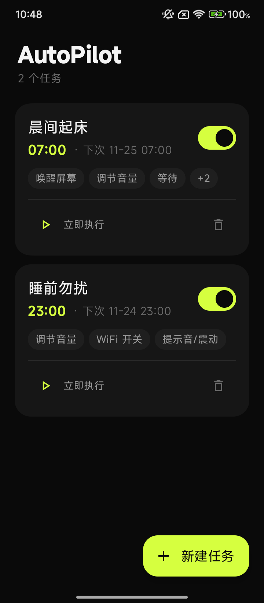
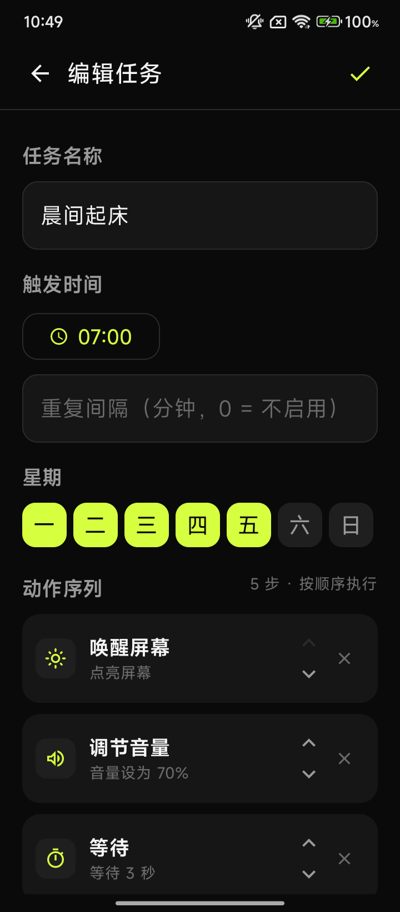
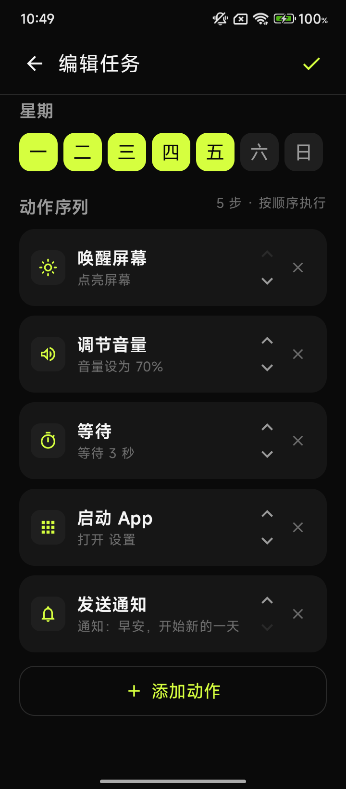
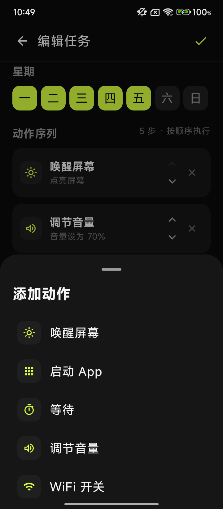
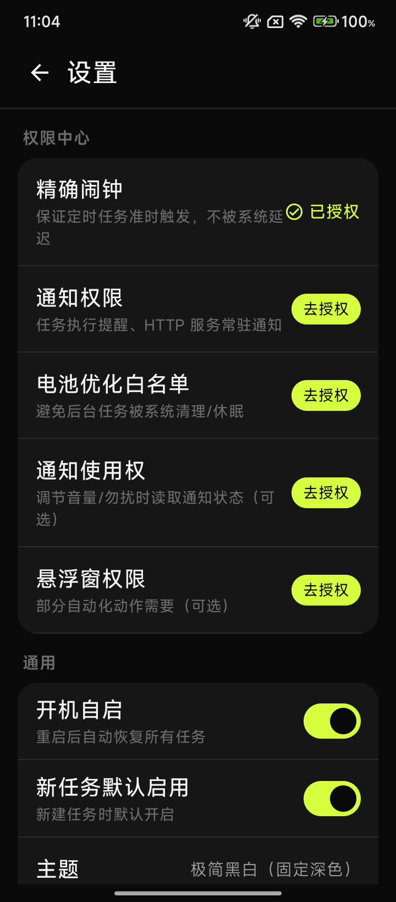

<div align="center">


# AutoPilot

**极简 Android 自动化 · 定时 → 唤醒屏幕 → 编排动作**  
*Minimal Android automation — scheduled wake + action sequences*

[](https://github.com/simon1uo/AutoPilot/actions/workflows/ci.yml)
[](https://github.com/simon1uo/AutoPilot/releases)
[](LICENSE)
[-D6FF3F.svg)](#)
[](#)

[中文](#中文) · [English](#english) · [截图](#截图--screenshots) · [贡献](CONTRIBUTING.md) · [发布](RELEASE.md) · [隐私](PRIVACY.md)

</div>

---

## 中文

AutoPilot 是一款**开源、免费、无订阅**的轻量 Android 自动化工具。它专注于一件简单的事：
**在指定时间自动唤醒屏幕，并按顺序执行一串动作**（打开 App、调音量、等待、发通知等）。

所有数据仅保存在本地设备，不上传、不追踪、无广告（见 [隐私政策](PRIVACY.md)）。

### 功能
- **任务列表**：启停 / 立即执行 / 删除
- **定时规则**：每天 HH:mm + 选星期几，或「每 N 分钟/小时」重复
- **多动作序列**：一个任务可编排多个动作，按顺序执行，支持添加 / 删除 / 排序
  - 动作类型：唤醒屏幕 · 启动 App · 等待 · 调节音量 · WiFi 开关 · 蓝牙开关 · 发送通知 · 提示音/震动
- **到点执行**：精确闹钟唤醒（可在待机中触发）→ 按序列执行动作
- **内建 HTTP 控制服务**（默认 :8080）：脚本化增删改查、立即执行
- **ADB 直通**：`am broadcast` 命令控制，测试无需手动点屏幕
- **权限中心**：集中检测并引导精确闹钟 / 通知 / 电池优化白名单 / 通知使用权
- **开机自动恢复**所有任务
- **极简黑白 + 荧光绿** UI（Material 3）

### 下载
前往 [Releases](https://github.com/simon1uo/AutoPilot/releases) 下载最新 APK。

### 构建
```bash
# 需要 JDK 21 + Android SDK (build-tools 35+, platform 36)
export JAVA_HOME=/path/to/jdk-21
export ANDROID_HOME=$HOME/Library/Android/sdk
cd app
./gradlew assembleDebug
adb install -r app/build/outputs/apk/debug/app-debug.apk
```

### HTTP 控制 API
服务默认在 `http://<手机IP>:8080`（App 在前台时自动启动）：

| 方法 | 路径 | 说明 |
|---|---|---|
| GET | `/api/health` | 健康检查 |
| GET | `/api/tasks` | 列出所有任务 |
| POST | `/api/tasks` | 新建任务（body 为 Task JSON） |
| POST | `/api/tasks/{id}/trigger` | 立即执行 |
| POST | `/api/tasks/{id}/toggle` | 启停切换 |
| DELETE | `/api/tasks/{id}` | 删除 |

### ADB 直通
```bash
# 列出任务
adb shell am broadcast -a io.github.simon1uo.autopilot.CONTROL \
  -n io.github.simon1uo.autopilot/.control.ControlReceiver --es cmd list
# 立即执行
adb shell am broadcast -a io.github.simon1uo.autopilot.CONTROL \
  -n io.github.simon1uo.autopilot/.control.ControlReceiver --es cmd trigger --el id <id>
```

### 从 MacroDroid 导入任务
AutoPilot 支持把 MacroDroid 的备份（`.mdr` 文件，JSON 格式）转换为 AutoPilot 任务：

```bash
# 1. 从手机取出 MacroDroid 自动备份（路径可能因版本不同）
adb pull "/sdcard/Android/data/com.arlosoft.macrodroid/files/MacroDroid/AutoBackup/<备份>.mdr" backup.mdr
# 2. 转换为 AutoPilot 任务 JSON
python3 scripts/md_to_autopilot.py backup.mdr autopilot_tasks.json
# 3. 通过 HTTP API 导入（或复制 JSON 后在 设置→数据管理→导入 粘贴）
```
支持映射：TimerTrigger→定时、ScreenOn→唤醒屏幕、LaunchActivity→启动App、Wait、SetVolume、WiFi/蓝牙、通知。

### 技术栈
Kotlin · Jetpack Compose · MVVM · NanoHTTPD · kotlinx.serialization · minSdk 26 / targetSdk 36

---

## English

AutoPilot is an **open-source, free, no-subscription** lightweight Android automation tool.
It focuses on one simple job: **wake the screen at a scheduled time and run a sequence of actions**
(launch an app, set volume, wait, send a notification, and more).

All data stays on your device — no upload, no tracking, no ads (see [Privacy Policy](PRIVACY.md)).

### Features
- **Task list** — enable/disable, run now, delete
- **Scheduling** — daily HH:mm with weekday selection, or repeat every N minutes/hours
- **Multi-action sequences** — chain multiple actions per task, executed in order; add / delete / reorder
  - Action types: Wake screen · Launch app · Wait · Set volume · Wi-Fi toggle · Bluetooth toggle · Notify · Beep/vibrate
- **Fire on time** — exact alarm wake-up (works in Doze) → run the sequence
- **Built-in HTTP control server** (default :8080) — CRUD + trigger from scripts
- **ADB control** — drive it via `am broadcast`, no tapping needed for tests
- **Permissions center** — check & guide exact alarm / notifications / battery optimization whitelist / notification access
- **Restores all tasks on boot**
- **Minimal black & white + neon green** UI (Material 3)

### Download
Grab the latest APK from [Releases](https://github.com/simon1uo/AutoPilot/releases).

### Build
```bash
# Requires JDK 21 + Android SDK (build-tools 35+, platform 36)
export JAVA_HOME=/path/to/jdk-21
export ANDROID_HOME=$HOME/Library/Android/sdk
cd app
./gradlew assembleDebug
adb install -r app/build/outputs/apk/debug/app-debug.apk
```

### Tech stack
Kotlin · Jetpack Compose · MVVM · NanoHTTPD · kotlinx.serialization · minSdk 26 / targetSdk 36

---

## 截图 / Screenshots

<div align="center">

| 任务列表 / Task list | 编辑任务 / Edit task | 动作序列 / Actions | 添加动作 / Add action | 设置·权限中心 / Settings |
|:---:|:---:|:---:|:---:|:---:|
|  |  |  |  |  |

</div>

---

## License
[MIT](LICENSE) © 2026 simon1uo · 第三方开源许可见 [LICENSES.md](LICENSES.md)

## Contributing
见 [CONTRIBUTING.md](CONTRIBUTING.md)（Conventional Commits + SemVer）· See CONTRIBUTING.md